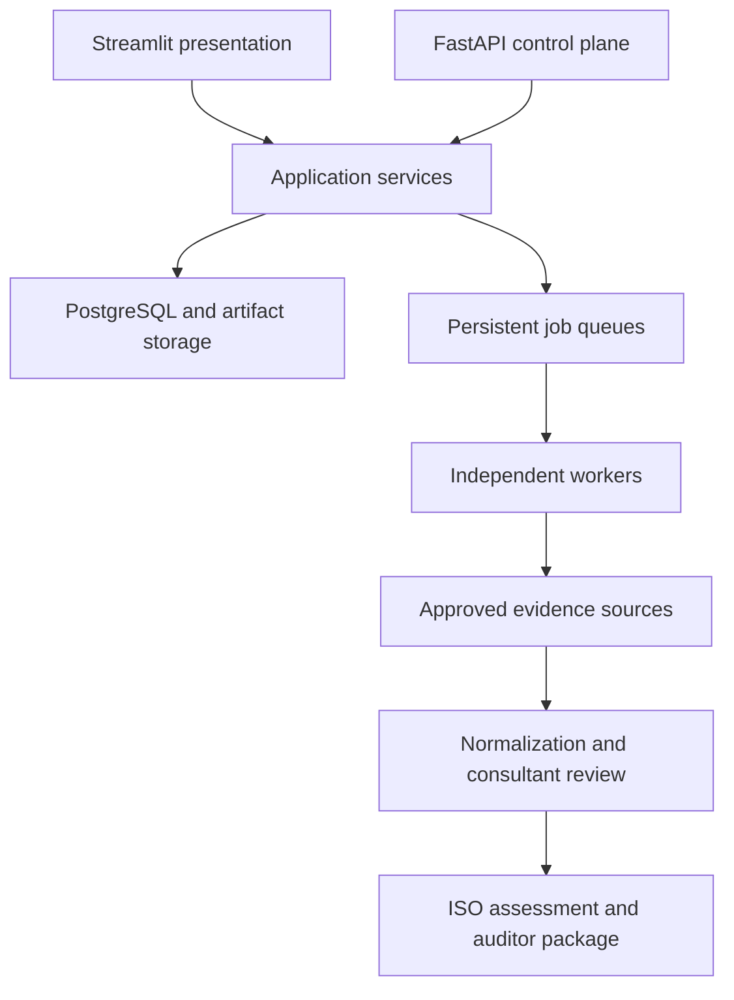

# SecureScope

SecureScope is a workspace-isolated exposure-management and ISO/IEC 27001
evidence platform. It combines security evidence, manual governance evidence,
consultant validation, PostgreSQL traceability, reporting, and controlled
remediation while preserving the established Streamlit application.

> Current evaluation build: **v5.4.9.dev0 — remediation in progress**.
> Phase 0 addresses build gates and version consistency. Phase 1 security
> requirements remain blocking before a production release.
> Scores use current validated assessments and evidence from the client workspace.
> [Start here](START_HERE.md) for Windows setup, changes and validation limits.
> See the [UI hardening and toolkit audit](docs/releases/SECURESCOPE_UI_HARDENING_AUDIT.md)
> for the bug-by-bug patch map, template mappings, export fidelity limits and
> the Streamlit versus React decision.


## Capabilities

- Client workspaces with isolated assets, campaigns, findings, and evidence.
- Guided organization discovery that converts a short client profile into reusable
  organization facts with provenance.
- Deterministic, human-reviewed Context and Interested-Party starter recommendations.
- Scope Composer that assembles a draft statement from confirmed products/services,
  departments, locations and technologies without bypassing scope approval.
- Manual GRC registers remain available as advanced/fallback editing surfaces.
- Engagement and certification-cycle context for every GRC record.
- Versioned ISMS scopes with human approval and immutable approved versions.
- Internal/external issues, climate relevance, interested parties and requirements.
- User-backed engagement roles, ISMS RACI assignments and milestones.
- ISO 27001 Assurance Command Center with conservative foundation progress.
- Dashboard KPI cards for foundation progress, controls assessed, open gaps, and
  approved-evidence coverage, with control-assurance and evidence visual panels.
- Streamlit 1.62.x modern page routing, fragments and Components v2 with safe native fallbacks.
- Visible bordered form fields and readable Control/SoA navigation buttons.
- Persistent client → engagement → scope context on every programme page.
- Lazy Programme Setup section routing without nested GRC tabs.
- On-demand dialogs for short create and assignment actions.
- Dedicated six-step scope-version editor with separate human approval.
- Compact, sectioned control-assessment, target, treatment and risk-acceptance forms.
- Consultant-facing remediation registers without raw UUID-heavy database views.
- Nmap asset discovery and technical enrichment.
- Durable OpenVAS/Greenbone and ProjectDiscovery Nuclei scan workers.
- Wazuh monitoring and ISO A.8.17 clock-synchronization evidence.
- Findings normalization, NVD/EPSS/CISA KEV enrichment, and PDF reports.
- ISO/IEC 27001:2022 clauses 4–10 and all 93 Annex A controls.
- ISO Evidence Hub with 31 open-source sources, manual evidence, consultant review,
  printable control matrix and checksum-verified auditor package.
- FastAPI control plane and an independent persistent defensive-collector worker.
- CISO Assistant synchronization remains an external integration.
- Default-off, allow-listed remediation with mandatory verification.

## Architecture



The Streamlit frontend now uses a hidden `st.navigation` registry behind the
custom SecureScope sidebar. High-interaction pages use fragments, and the first
Stitch-native KPI, journey and enterprise-table surfaces use Components v2.
Shared repositories borrow PostgreSQL connections from a process-wide threaded
pool; long-running scanner execution remains in independent workers. See
[Streamlit modernization](docs/architecture/STREAMLIT_MODERNIZATION_V5_4_0.md).

The Python package follows a `src/` layout:

- `core` — provider-neutral domain rules and shared utilities.
- `ui` — reusable Streamlit presentation components.
- `persistence` — PostgreSQL repositories and migrations.
- `integrations` — Wazuh, CISO Assistant, NTP, and vulnerability intelligence.
- `scanners` — isolated Nmap, OpenVAS, and Nuclei implementations.
- `reporting` — provider and consolidated report generation.
- `compliance` — ISO assessment and controlled remediation workflows.
- `grc` and `evidence` — engagements, scope, control catalog, evidence lifecycle,
  and safe collectors.
- `api` — workspace-authenticated FastAPI control plane.
- `validation` and `cli` — operational checks and command-line entry points.

See [Project structure](docs/PROJECT_STRUCTURE.md) and
[Architecture overview](docs/architecture/OVERVIEW.md).

## Windows quick start

Requirements: Windows 10/11, Python 3.11, PostgreSQL, Nmap, and at least one
configured scanner engine.

```powershell
Copy-Item .env.example .env
notepad .env
Set-ExecutionPolicy -Scope Process Bypass
.\start_securescope.ps1
```

Open `http://localhost:8501` after startup. The launcher creates `.venv`,
installs dependencies, applies additive database migrations, starts configured
workers, and launches Streamlit.

The migration runner safely recognizes the exact published migration-003
checksums from earlier SecureScope ISO Evidence packages. It then applies
migration 004 additively, so no manual edit to
`securescope_schema_migrations` and no database reset are required. Migration
005 then creates the engagement/context/scope foundation and backfills one
draft engagement and scope for every existing client workspace without changing
scanner, evidence, assessment or report rows. Migration 006 adds only organization
profiles and provenance-aware organization facts used by guided Discovery.

Before Evidence Hub mutations, create a workspace membership and configure the
same email in `.env`:

```powershell
$env:PYTHONPATH = ".\src"
.\.venv\Scripts\python.exe -m securescope.cli.manage_membership `
  --workspace "Default Client" `
  --email "consultant@example.com" `
  --name "ISO Consultant" `
  --role "Consultant" `
  --granted-by "Local administrator"
```

Then set `SECURESCOPE_CURRENT_USER_EMAIL=consultant@example.com`. Optional
independent processes can be started with `scripts/windows/start_api.ps1` and
`scripts/windows/start_evidence_worker.ps1`.

Useful maintenance commands are grouped under `scripts/windows/`:

```powershell
.\scripts\windows\run_tests.ps1
.\scripts\windows\run_full_validation.ps1
.\scripts\windows\run_nuclei_diagnostics.ps1
.\scripts\windows\run_openvas_diagnostics.ps1
```

## Development

```powershell
py -3.11 -m venv .venv
.\.venv\Scripts\Activate.ps1
python -m pip install -r requirements-dev.txt
python -m pip install -e .
python -m compileall -q src tests
python -m pytest -q
```

Never commit `.env`, scanner output, credentials, SSH keys, API tokens, or
generated reports. A private GitHub repository is recommended for enterprise
evaluation. Read [Security policy](SECURITY.md) before sharing the project.

## Documentation

- [Executive overview](docs/EXECUTIVE_OVERVIEW.md)
- [User manual](docs/USER_MANUAL.md)
- [Acceptance test](docs/ACCEPTANCE_TEST.md)
- [Control evidence matrix](docs/CONTROL_EVIDENCE_MATRIX.md)
- [Nuclei quick start](docs/NUCLEI_QUICKSTART.md)
- [Wazuh Active Response setup](docs/WAZUH_ACTIVE_RESPONSE_SETUP.md)
- [ISO Evidence Hub](docs/ISO_EVIDENCE_HUB.md)
- [ISO control automation matrix](docs/ISO_CONTROL_AUTOMATION_MATRIX.md)
- [Open-source tool installation](docs/OPEN_SOURCE_TOOL_INSTALLATION.md)
- [Development quality guide](docs/development/QUALITY.md)
- [GitHub publication guide](docs/development/GITHUB_SETUP.md)

## Security boundary

The default Nuclei profile excludes denial-of-service, fuzzing, and brute-force
tags. Approved endpoint remediation is disabled by default and accepts only
integrity-checked, administrator-allow-listed recipes. These controls do not
replace written scan authorization, change management, or environment-specific
risk review.
