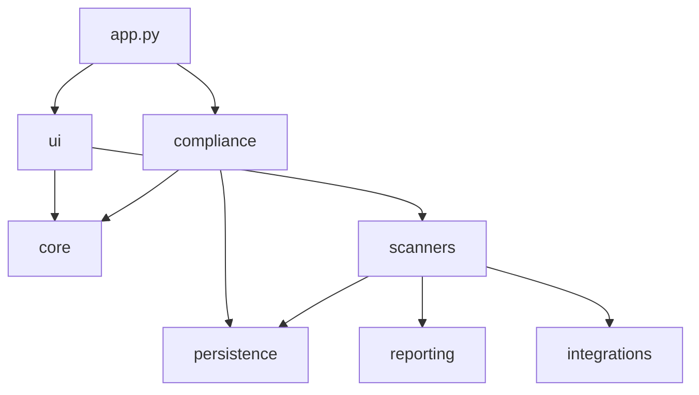

# Project structure

```text
SecureScope/
├── .github/workflows/       Continuous integration
├── .streamlit/              Streamlit runtime configuration
├── config/                  Reviewed application configuration
├── database/                Bootstrap SQL and ordered migrations
├── docs/                    Architecture, operations, security, and releases
├── integrations/wazuh/      Wazuh agent probes, manager rules, and remediation
├── scripts/windows/         Diagnostics, workers, tests, and maintenance
├── src/securescope/         Installable Python package
│   ├── app.py               Streamlit entry point
│   ├── paths.py             Canonical repository/runtime paths
│   ├── core/                Provider-neutral domain rules
│   ├── ui/                  Streamlit components and themes
│   ├── persistence/         PostgreSQL repositories
│   ├── integrations/        External service adapters
│   ├── scanners/            Nmap, OpenVAS, and Nuclei implementations
│   ├── reporting/           PDF and evidence generation
│   ├── compliance/          ISO assurance and remediation
│   ├── grc/                 Engagement, scope and control domain services
│   ├── evidence/            Evidence lifecycle and safe collectors
│   ├── api/                 Workspace-authenticated FastAPI control plane
│   ├── validation/          Non-destructive system validation
│   └── cli/                 Command-line entry points
├── tests/                   Unit and regression tests
├── exports/                 Generated exports; contents ignored by Git
├── logs/                    Runtime logs; contents ignored by Git
├── reports/                 Generated reports; contents ignored by Git
├── .env.example             Safe configuration template
├── pyproject.toml           Package and tool configuration
├── requirements.txt         Runtime dependencies
├── requirements-dev.txt     Development and documentation tools
└── start_securescope.ps1    Windows bootstrap and application launcher
```

## Dependency direction



Runtime files are intentionally outside `src/`. Source code must not write
generated results into the Python package.
