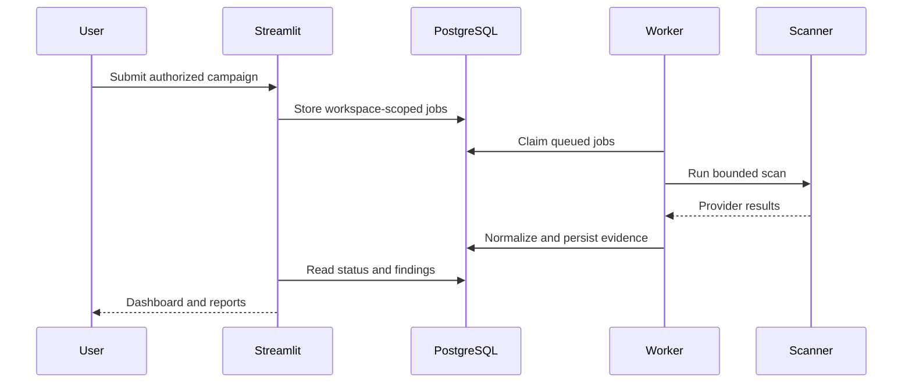

# Architecture overview

SecureScope uses a modular monolith with independent persistent workers. The
Streamlit process owns presentation and job submission, while PostgreSQL is the
source of truth for workspace identity, campaigns, attempts, evidence, and
worker state.

## Runtime flow

## Architectural boundaries

- `core` has no scanner-specific execution responsibility.
- `persistence` owns database access and client scoping.
- `scanners` owns provider lifecycle and bounded subprocesses.
- `integrations` owns external API boundaries.
- `compliance` converts evidence into assessments and controlled actions.
- `grc` owns the short-label catalog for clauses 4–10 and all Annex A controls.
- `evidence` owns source policy, normalization, raw artifacts, review and safe collectors.
- `api` exposes workspace-authenticated service routes without scanner execution.
- `reporting` produces the printable matrix and checksum-verified auditor package.
- `ui` renders state but does not own durable scanner lifecycle. The custom
  sidebar sits over a hidden Streamlit page registry and selected Stitch-style
  surfaces may use Components v2 with native fallbacks.

## Incremental roadmap

`app.py` still contains legacy page implementations, but it no longer owns the
top-level if/elif router. Future refactoring should continue extracting one
page controller at a time into `ui/pages/`, leaving durable business logic in
application/domain/persistence services. This remains an incremental migration,
not a high-risk frontend rewrite.

See [Streamlit modernization v5.4.0](STREAMLIT_MODERNIZATION_V5_4_0.md).
