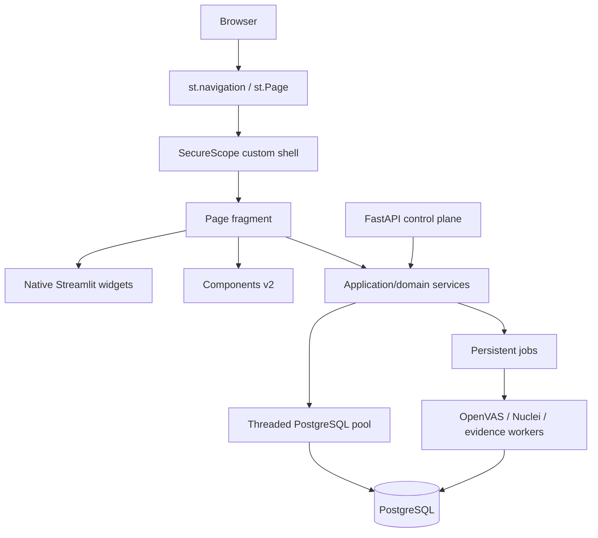

# Streamlit modernization — v5.4.0

SecureScope v5.4.0 keeps Streamlit as the presentation framework while
modernizing the application around the current Streamlit routing, fragment and
Components v2 APIs. The change is deliberately incremental: PostgreSQL schemas,
scanner workers, evidence semantics, ISO assessment decisions, SoA, gap actions,
risk treatment and report workflows are preserved.

## Goals

- Make Streamlit a presentation layer instead of the top-level business router.
- Give every first-class workspace a stable URL and page object.
- Prevent local interactions from rerunning unrelated dashboard/workspace code.
- Provide a safe path to richer Stitch-style tables and dashboard components.
- Reduce repeated PostgreSQL connection setup during concurrent dashboard reads.
- Preserve the existing FastAPI control plane and future React migration option.

## Runtime architecture



## Navigation

`src/securescope/ui/navigation.py` is the route registry. It declares visible
and contextual pages with `st.Page`. SecureScope calls `st.navigation(...,
position="hidden")`, so Streamlit owns the URL and active page while the
existing Stitch-style sidebar remains the visible navigation surface.

The stable internal route keys are retained so existing contextual actions can
be migrated incrementally. `ui/navigation_runtime.py` provides the bridge and
uses `st.switch_page` when the page registry is available.

Hidden contextual routes remain registered for:

- Asset Discovery
- Technical Assurance
- Evidence Hub

They are intentionally not separate primary sidebar destinations.

## Fragments

High-interaction page renderers are fragment boundaries. This means a widget
interaction can rerun its current workspace instead of executing the complete
SecureScope entrypoint. Independent technical-coverage work in Command Center
uses a parallel fragment because Wazuh/coverage reads do not need to block the
rest of the dashboard.

Persistent scanner execution remains outside fragments and outside the web
request. The UI submits jobs and renders persisted worker state.

## Components v2

`src/securescope/ui/components_v2/` contains the first SecureScope native
Components v2 implementations:

- KPI grid
- Certification journey
- Enterprise table

Components contain only application-owned HTML/CSS/JavaScript. Database and
user-provided values are passed in the structured `data` payload and inserted
with DOM `textContent`. Dynamic values are never concatenated into component
HTML, CSS or JavaScript.

The enterprise table provides client-side search, pagination, sticky headers,
status chips, progress cells and row-selection triggers. A normal Streamlit
`st.dataframe` path remains as a compatibility fallback.

## PostgreSQL connection pool

`persistence/db_service.py` now uses `ThreadedConnectionPool`. It is process
wide, lazy, thread-safe and automatically closed at shutdown.

Configuration:

```text
SECURESCOPE_DB_POOL_MIN=1
SECURESCOPE_DB_POOL_MAX=12
```

The defaults are conservative for a local consultant workstation. Worker
services that intentionally own long-lived/dedicated connections are not
silently moved into the UI pool.

## Stitch design system

The approved Stitch system is captured as Python tokens in
`ui/design_system/tokens.py` and in Streamlit theme configuration. Core values:

- primary teal: `#00685f`
- assurance navy: `#0f172a`
- app background: `#f8f9ff`
- surface: `#ffffff`
- card radius: 10px
- control radius: 6px
- desktop gutter: 24px

Typography is Inter-first in custom components with Segoe UI/system fallbacks.
No external font or icon download is required for the application to remain
usable on an offline Windows environment.

## Compatibility boundary

This release does **not**:

- change ISO/IEC 27001 control status semantics;
- make scanner evidence an automatic compliance decision;
- remove Control Profiles, Assess Control, Evidence, Gap Actions, SoA or RTP;
- move OpenVAS/Nuclei execution into Streamlit;
- replace PostgreSQL migrations;
- require a React/Next.js frontend.

The resulting service boundary makes a later React/FastAPI frontend possible
without requiring it now.
